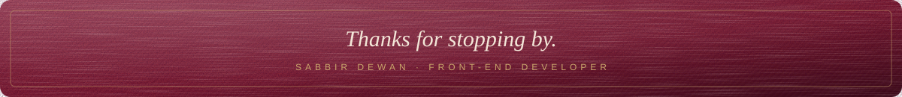

  

  
  
  

## About Me

I am a front-end developer in Dhaka, Bangladesh, and a Computer Science and Engineering student. I build responsive, component-based interfaces with React, and I care about layouts that stay clean from a phone screen to a wide desktop. My projects use Redux Toolkit for state, React Router for navigation, and Firebase or public REST APIs for data. I am strengthening my JavaScript fundamentals every week, and my goal is to grow into a full-stack developer. I am open to junior front-end internships and to collaboration.

## Current Focus

Right now I am building more responsive React applications and working through core JavaScript topics such as closures, async and await, and array methods. I am adding real authentication with Firebase to my projects, preparing for the backend part of my full-stack course in 2027, and getting ready for a junior front-end internship in Dhaka.

## Tech Stack

  
  
  
  
  

  
  
  
  
  

  
  
  
  
  

## GitHub Overview

  <picture>
    <source media="(prefers-color-scheme: dark)" srcset="https://raw.githubusercontent.com/dewanxt/dewanxt/output/github-snake-dark.svg" />
    <source media="(prefers-color-scheme: light)" srcset="https://raw.githubusercontent.com/dewanxt/dewanxt/output/github-snake.svg" />
    
  </picture>

  

## Get in Touch

I am happy to talk about internships, junior roles, and small freelance projects. The quickest way to reach me is by email at [sabbirdewann@gmail.com](mailto:sabbirdewann@gmail.com), and you can also message me on [LinkedIn](https://www.linkedin.com/in/dewanxt/) or look through my [portfolio](https://portfolio-zh8o.vercel.app/).

